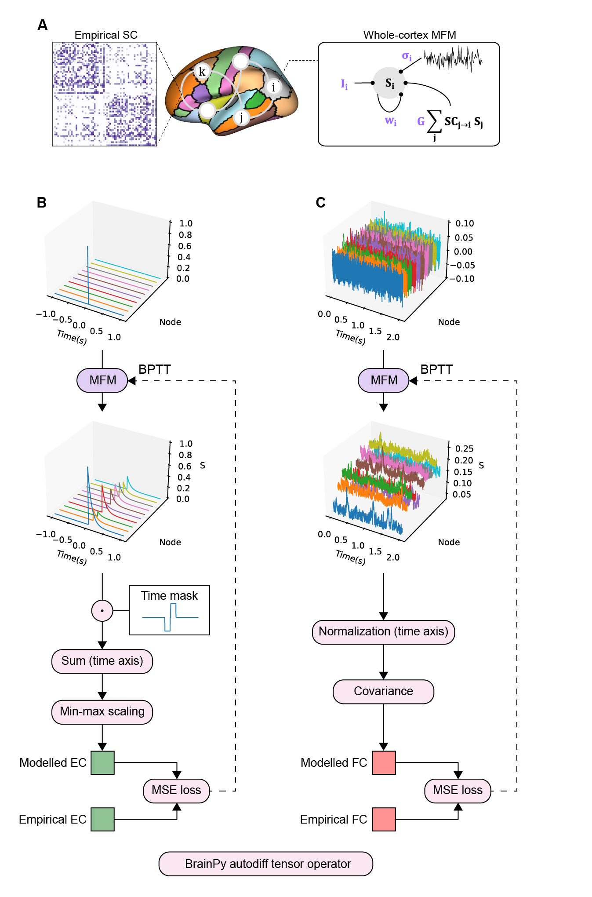

This repository contains code and data for a manuscript “A dynamical mechanism for opposing cortical gradients in resting-state functional and stimulation-derived effective connectomes” on cross-modality training of a whole-cortex mean-field model (MFM) in BrainPy (https://github.com/brainpy/BrainPy). The model combines reduced Wong–Wang–Deco dynamics (https://www.jneurosci.org/content/33/27/11239) with Balloon–Windkessel hemodynamics to simulate large-scale cortical dynamics. We use backpropagation through time (BPTT) to fit effective connectivity (EC) and functional connectivity (FC) in two stages or in a single stage with a hybrid loss. The manuscript is currently in the submission process.

Dr. Xiaoyu Chen (chenxy_sjtu@sjtu.edu.cn) and Yixiao Feng (yf2887@nyu.edu) contributed as a postdoctoral researcher and an undergraduate student, respectively, at LCNS, SJTU, Shanghai (https://lcns-sjtu.github.io/).

**Connectome-based, end-to-end gradient-based training of a whole-cortex MFM.**

**A** The whole-cortex mean-field model represents each of the 68 Desikan–Killiany cortical regions with a synaptic gating variable $S_i$. Interregional interactions follow empirical structural connectivity (SC) and are scaled by the global coupling $G$. Regional recurrent strength $w_i$, background input $I_i$, and intrinsic noise amplitude $\sigma_i$ are independently trainable.

**B** EC fitting. A single pulse stimulates one node of the model, implemented as a recurrent neural network (RNN), and responses are recorded across nodes. A temporal mask combines pre-stimulus baseline subtraction with post-stimulus integration. Summation over time and scaling produce modelled EC. BPTT minimizes the mean squared error (MSE) between modelled and empirical EC to optimize $G$, $w_i$, and $I_i$.

**C** FC fitting. Noise inputs drive a resting-state simulation. Normalizing the regional time series and computing their covariance yields an FC matrix of Pearson correlations. BPTT minimizes the FC MSE and enables optimization of $\sigma_i$. All operations use differentiable BrainPy tensor operators.

# Environments

- **CPU** uses BrainPy 2.6.0, JAX 0.4.26, and jaxlib 0.4.26.
- **GPU** (NVIDIA A100) uses BrainPy 2.4.6.post5, JAX 0.4.20, and jaxlib 0.4.20+cuda11.cudnn86.

Newer BrainPy versions may require code changes.

# Code

Jupyter notebooks provide examples of model simulation and training. To limit repository size, we include training checkpoints for 26 retained cases (about 660 MB) from the original 170 cases (about 4 GB).

`0_test_example/` contains a basic notebook tutorial for running the MFM in BrainPy.

`1_plot_empirical_divergence/` contains two notebooks that illustrate empirical EC–FC divergence at the edge and node levels using EC, FC, and SC matrices from `prepare_SC_EC_FC.npz` in the repository root.

`2_plot_retained26cases/` contains a notebook for generating the main manuscript plots, along with training checkpoints from an NVIDIA A100 cluster.

`3_training_EC_FC_2stage/` contains two notebooks that demonstrate the two-stage EC–FC training pipeline using the hyperparameters of the best-performing model.

`4_training_hybrid_loss/` contains one notebook that demonstrates single-stage EC–FC training with a hybrid loss.

The Python modules provide model, simulation, training, analysis, and plotting functions.
